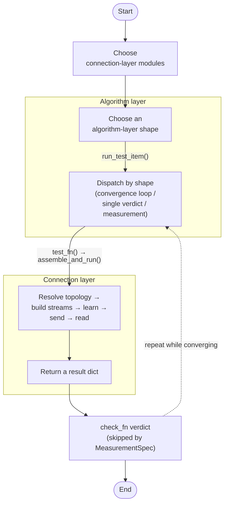
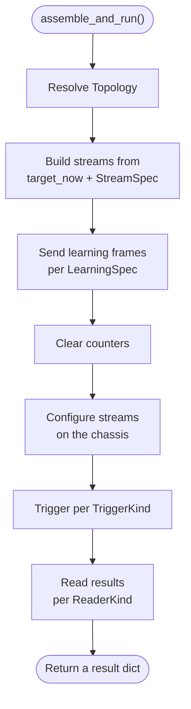
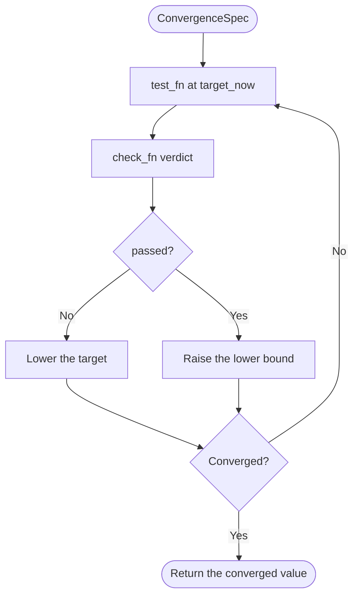

# XMNT — Python app

The Python implementation of XMNT (Xtramus Modular Network Testing). It drives Xtramus network test chassis directly through the vendor's NuPython SDK and is the reference implementation that the [web app](../web-app/) was ported from.

Any network test is assembled from the same two layers instead of being written from scratch:

- **Connection layer**: how to talk to the chassis (send commands, transmit frames, read counters). It knows nothing about any particular test.
- **Algorithm layer**: how to decide whether a test passed (convergence search, single verdict, measurement). It is fully decoupled from the hardware; with `cfg.simulate=True` the whole convergence logic runs on fake data with no chassis attached.

Between them sits a **declarative recipe system**: a new test is described by filling in data (dataclasses) that names the modules it needs, and a generic assembler turns that description into chassis operations. The current reference implementation is **RFC-2889**: all 8 of its tests, plus the general ManyToMany / FullyMesh topologies, have been run and verified on real hardware.

## Requirements

- Python 3 (developed on 3.12), standard library only: no `pip install` needed.
- An Xtramus test chassis (e.g. NuStreams-900) reachable from your PC, with the NIC on the chassis subnet (the chassis does not run DHCP).
- The NuPython SDK modules in this folder belong to Xtramus and are included with permission.
- Console output and error messages are in Traditional Chinese, the language of the tool's users; code and comments are in English.

## Files

| Group | Files | Role |
|---|---|---|
| Vendor SDK | [`NuPython.py`](NuPython.py), [`nucommand.py`](nucommand.py), [`nuconst.py`](nuconst.py), [`nupktstorage.py`](nupktstorage.py), [`nuprotocol.py`](nuprotocol.py), [`t451counter.py`](t451counter.py) | Xtramus's chassis-control SDK (see the modifications below) |
| Connection layer | [`nupython_xmnt.py`](nupython_xmnt.py), [`nupython_xmnt_mac_vary.py`](nupython_xmnt_mac_vary.py) | `NuPythonBackend` (connection lifecycle, stream setup, triggering, learning, reading) and the low-level stream/learning/trigger dataclasses; block math for hardware MAC auto-increment |
| Declarative recipes | [`nupython_xmnt_recipe_spec.py`](nupython_xmnt_recipe_spec.py), [`nupython_xmnt_recipe_assembly.py`](nupython_xmnt_recipe_assembly.py) | The five recipe dimensions as pure-data dataclasses, and the generic assembler that executes them |
| Algorithm layer | [`xmnt_config.py`](xmnt_config.py), [`xmnt_convergence.py`](xmnt_convergence.py), [`xmnt_checks.py`](xmnt_checks.py), [`xmnt_assembly.py`](xmnt_assembly.py) | `Config` + validation, binary/linear convergence, check functions, and the three assembly shapes with the `run_test_item()` entry point |
| RFC-2889 tests | `run_rfc2889_*_hardware.py` (8 scripts) | One script per RFC-2889 test, each a finished module combination |
| Mesh demos | [`run_xmnt_fullymesh_hardware.py`](run_xmnt_fullymesh_hardware.py), [`run_xmnt_manytomany_hardware.py`](run_xmnt_manytomany_hardware.py) | The general FullyMesh / ManyToMany topologies |
| Template | [`run_xmnt_template_hardware.py`](run_xmnt_template_hardware.py) | Every selectable module and all three shapes, with a fill-in skeleton for building a new test |

Modifications to the vendor SDK copy:

- `nuprotocol.py`: fixed a circular reference between the `ETHERNET` and `TRILL` classes that raised `NameError` on import.
- `NuPython.py`: removed the 96-bit lower bound in `config_stream_ifg` / `config_stream_ibg` so Forwarding Pressure can send gaps tighter than line rate.
- `NuPython.py` / `nucommand.py`: added `config_stream_vary` (hardware MAC auto-increment), used to accelerate Address Caching / Address Learning.

## Architecture



### Connection core: `NuPythonBackend`

`NuPythonBackend(cfg)` is the only object that talks to the chassis, and it manages the connection as a context manager:

```python
with NuPythonBackend(cfg) as backend:
    ...
```

- `open()`: connect → lock every port the config uses → resolve port indexes → configure ARP replies (if a config file exists) → read each port's negotiated speed.
- `close()`: nested `try/finally` that stops ARP replies → unlocks ports → disconnects → closes the log, so one failing step never skips the rest of the cleanup.
- Internal methods (`_configure_stream`, `_fire_trigger`, `_apply_learning`, `_read_monitor_received`, `_read_stream_latency`, `_clear_counters`) are called by the recipe assembler, not by test scripts.

### Declarative connection layer: five dimensions

A test's connection-layer behavior is fully described by `PhysicalRecipeSpec(topology, learning, stream, trigger, reader)`.

**1. Topology** (which ports, in which roles)

| Class | Ports | Notes |
|---|---|---|
| `OneToOneTopology.TwoPort()` | tx + rx | The simplest one-to-one test |
| `OneToOneTopology.ThreePortMonitor()` | tx + rx + monitor | Adds a monitor port that detects flooding; needs `cfg.monitor_port` |
| `ManyToMany()` | N tx + M rx | Partial mesh; needs `cfg.mesh_tx_ports` / `cfg.mesh_rx_ports` |
| `FullyMesh()` | N, each both tx and rx | Every port sends to every other; needs `cfg.mesh_ports` |

**2. LearningSpec** (how the DUT learns MAC addresses before the test)

| Class | Notes |
|---|---|
| `NoLearningSpec()` | No learning (broadcast tests need none: the DUT floods without a lookup) |
| `AddressLearningSpec()` | Standard unicast learning; in a mesh, one learning frame per receiving port |
| `VaryingAddressAgedLearningSpec(aging_time, mac_count, learning_loading)` | Address Caching / Learning: teaches and tests many MACs at once with hardware DA/SA vary. Leave exactly one of `mac_count` / `learning_loading` as `None`; that one is driven by the convergence target (this is not validated) |

**3. StreamSpec** (what the frames look like)

| Class | Notes |
|---|---|
| `UnicastStreamSpec(loading)` | Standard unicast; in a mesh every tx port sends to every other mesh port |
| `BroadcastStreamSpec(loading)` | All-ones destination |
| `ErrorSweepStreamSpec(error_types, loading, undersize_framesize, oversize_framesize)` | Errored frames: bad CRC / undersize / oversize / alignment |
| `PressureStreamSpec(gap_bits)` | Inter-frame gap below 96 bits, i.e. traffic above line rate |
| `MacSweepStreamSpec(loading)` | Older one-stream-per-MAC approach, kept but unused (superseded by `VaryingAddressAgedLearningSpec`) |

A `loading` of `None` is driven by the algorithm layer's convergence target (`target_now`); a number means that fixed loading %.

**4. TriggerKind**: `ImmediateSingleKind()` (one port, right after setup) or `SynchronizedMultiKind()` (several ports at once via the chassis's global-start broadcast).

**5. ReaderKind** (how results are read)

| Class | Returns | Notes |
|---|---|---|
| `PortCountersReaderKind(aggregate, per_port_detail, keep_per_stream_results, use_stream_counters)` | `tx_packets` / `rx_packets` | Port counters, summed over ports in a mesh; the flags add per-port detail, per-stream results, or switch to per-slot stream counters |
| `MonitorReceivedReaderKind()` | `monitor_received` | Whether the monitor port received anything; works with any topology |
| `StreamLatencyReaderKind()` | `latency`, or `pairwise_latency_matrix` in a mesh | Stream-level latency, for `MeasurementSpec` |
| `PairwiseStreamReaderKind()` | `pairwise_matrix` or `pairwise_error_matrix` | Mesh only: per-(sender, receiver) counters; the shape follows the stream type |

`reader` may also be a tuple, e.g. `(MonitorReceivedReaderKind(), PortCountersReaderKind())`.

Unsupported combinations: `VaryingAddressAgedLearningSpec` works only with `OneToOneTopology`; `PairwiseStreamReaderKind` works only with mesh topologies; in a mesh, `StreamLatencyReaderKind` works only with unicast/broadcast streams.

The assembler (`nupython_xmnt_recipe_assembly.py`) runs one round as a straight line, with no loop (looping belongs to the algorithm layer):



`make_convergence_test_fn(recipe_spec)` / `make_single_test_fn(recipe_spec)` wrap the assembler into the `test_fn` the algorithm layer expects and handle `cfg.simulate` automatically.

### Algorithm layer: `Config` + three shapes

`Config` (`xmnt_config.py`) is one flat parameter set shared by every test: ports, frame-size sweep, convergence range, transmit mode, learning parameters, test-specific fields and connection timing. `validate(cfg)` checks the fields `cfg.test_type` requires. Frame sizes come from `get_framesizes(cfg)`: a custom list (`mode_framesize=0`) or a start/stop/step sweep (`mode_framesize=1`), and every frame size gets its own round.

| Shape | Purpose | Runs |
|---|---|---|
| `ConvergenceSpec(test_fn, check_fn, result_key, mode_convergence, target_min, target_max, target_now, target_step, target_resolution)` | Find a threshold by adjusting one value repeatedly | `run_convergence_framesize()` |
| `SingleTestSpec(test_fn, check_fn)` | One trial, pass/fail | `run_single_test()` |
| `MeasurementSpec(test_fn)` | One measurement, no verdict | `run_measurement()` |



Convergence runs as a binary search (`mode_convergence=0`, the default: pass raises the lower bound, fail first drops 20% and then closes in, until the range is narrower than `target_resolution`) or a linear sweep (`mode_convergence=1`: step from `target_min` to `target_max` by `target_step` and report the last passing value).

Check functions (`xmnt_checks.py`):

| Logic | Basic | With detail | Used by |
|---|---|---|---|
| Frames sent vs. received | `check_loss_based` | `check_loss_based_with_detail` | Forwarding, Broadcast Forwarding, Congestion Control, mesh loading convergence |
| Receive count must be 0 | `check_rx_zero` | `check_rx_zero_with_full_detail` | Error Filtering (one-to-one and mesh) |
| Did the monitor port receive anything | `check_monitor_received` | `check_monitor_received_with_detail` | Forwarding Pressure, Address Caching, Address Learning |

The `_with_detail` variants keep extra fields and switch to per-pair verdicts when the result contains `pairwise_matrix` / `pairwise_error_matrix`. `result_key` only names the converged value in the output (`"throughput"` by default, `"converged_mac_count"` for Address Caching).

### Putting the two layers together

```python
recipe_spec = PhysicalRecipeSpec(topology=..., learning=..., stream=..., trigger=..., reader=...)

spec = ConvergenceSpec(                               # or SingleTestSpec / MeasurementSpec
    test_fn=make_convergence_test_fn(recipe_spec),    # or make_single_test_fn(recipe_spec)
    check_fn=check_loss_based,                        # the check that matches the reader
    ...
)

with NuPythonBackend(cfg) as backend:
    results = run_test_item(cfg, spec, backend=backend)   # {frame_size: result}
```

With `cfg.simulate=True`, `run_test_item(cfg, spec, fake_result_fn=...)` validates the convergence and verdict logic with no hardware at all.

## Test coverage

All of the following have been run and verified on a real chassis.

| Test | Topology | Learning | Stream | Trigger | Reader | Shape |
|---|---|---|---|---|---|---|
| Forwarding | TwoPort | AddressLearning (optional) | Unicast | ImmediateSingle | PortCounters | Convergence |
| Broadcast Forwarding | TwoPort | NoLearning | Broadcast | ImmediateSingle | PortCounters | Convergence |
| Congestion Control | ManyToMany (2 tx → 1 rx) | AddressLearning (optional) | Unicast | SynchronizedMulti | PortCounters (per-port detail) | Convergence |
| Error Filtering | TwoPort | AddressLearning (optional) | ErrorSweep | ImmediateSingle | PortCounters (sum, per-stream, stream counters) | SingleTest |
| Forwarding Pressure | ThreePortMonitor | AddressLearning (optional) | Pressure | ImmediateSingle | (MonitorReceived, PortCounters) | SingleTest |
| Broadcast Latency | TwoPort | NoLearning | Broadcast | ImmediateSingle | StreamLatency | Measurement |
| Address Caching | ThreePortMonitor | VaryingAddressAged (MAC count converges) | — | — | MonitorReceived | Convergence |
| Address Learning | ThreePortMonitor | VaryingAddressAged (learning rate converges) | — | — | MonitorReceived | Convergence |
| FullyMesh demo | FullyMesh | AddressLearning | Unicast / ErrorSweep | SynchronizedMulti | PairwiseStream | Convergence / SingleTest |
| ManyToMany demo | ManyToMany | AddressLearning | Unicast / ErrorSweep | SynchronizedMulti | PortCounters (Unicast) / PairwiseStream (ErrorSweep) | Convergence / SingleTest |

## Engineering challenges

The framework was developed test-first against a fake chassis that records every SDK call (about 380 unit tests, not included in this repository). A fake only checks which calls are made, not how the hardware reacts to them, so several bugs appeared only on the real chassis. Four of them are described below, with the measurements that exposed them.

A reference figure used throughout: at 64-byte frames on a 1 Gb/s link, line rate is 1,488,095 frames/s, so a 2-second transmit window at full load carries 2,976,190 frames.

### 1. Address learning slowed down every test after it

- **Symptom.** The first real Forwarding run sent only 38 frames in a 2-second window at 98.4% load, where about 2.9 million were expected.
- **Investigation.** The same run with learning turned off sent 2,976,190 frames, exactly line rate, which pointed at the learning step. The SDK source showed why: the transmit-rate mode is one global flag on the SDK object. Learning switched it to manual mode with deliberately wide gaps, and nothing switched it back. The flag is also only applied at the next stream setup, so it slowed the following test stream rather than the learning frames.
- **Fix.** Set manual mode before the learning stream is configured and reset it to automatic afterwards (`_send_learning_frames` in [`nupython_xmnt.py`](nupython_xmnt.py)), with regression tests on the call order. With learning back on, Forwarding again converged to 2,976,190 frames.

### 2. A pressure test that passed without applying pressure

- **Symptom.** Forwarding Pressure exceeds line rate by sending with 88-bit inter-frame gaps, below Ethernet's 96-bit minimum, and checks that the switch does not flood the overload to a monitor port. Every run passed, which on its own did not prove the switch coped.
- **Investigation.** With transmit and receive counts added to the result, the transmit count was exactly 2,976,190, the normal line-rate figure, instead of the 3,012,048 frames that 88-bit gaps produce. The SDK's time-based transmit mode derives the frame count from the load percentage, which manual-gap streams never set, so the chassis sent the normal number of frames faster and stopped early instead of overloading the link for the whole window.
- **Fix.** Compute the frame count from the gap length (`_pressure_burst_frames` in [`nupython_xmnt_recipe_assembly.py`](nupython_xmnt_recipe_assembly.py)) and transmit in frame-count mode. The next run sent 3,012,048 frames, the receiving port got 2,977,207, and the monitor port saw no flooding. A separate run sent frames addressed to the monitor port on purpose and the reader reported them, so "no flooding" was a real result, not a reader that always says no.

### 3. Two identical ports, 2.5× different traffic

- **Symptom.** Congestion Control drives one receiving port from two sending ports at the same load, but one port sent 3,720,238 frames and the other 1,488,094, a ratio of 2.50003.
- **Investigation.** That ratio is exactly 2.5 Gb/s against 1 Gb/s, so the first hypothesis was mismatched link speeds. A diagnostic script read the negotiated speed of all three ports directly: all were 2.5 Gb/s, which ruled it out. The cause was in connection setup, which fetched link information for the transmit, receive and monitor ports but never for the second transmit port. That port's speed stayed at the SDK's default of 1 Gb/s, and its frame rate was computed from the default.
- **Fix.** Fetch link information for the second transmit port too (`NuPythonBackend.open()` in [`nupython_xmnt.py`](nupython_xmnt.py)).

### 4. A hardware limit behind inconsistent error-filtering results

- **Symptom.** In the full-mesh Error Filtering test, every port sends four kinds of errored frames (bad CRC, undersize, alignment error, oversize) to every other port at once. The results contradicted the single-pair version of the same test, and which error type came out wrong changed from run to run.
- **Investigation.** Each error type run on its own matched the single-pair results; only mixing all four on one port went wrong, for two reasons. First, the SDK sizes a port's transmit budget from whichever stream was configured last, so all four types were sent with the oversize frame count. Second, reversing the configuration order made all four types vanish at the receiver, confirmed by packet capture: although the SDK sends each stream's error setting separately, the chassis applies only the last one to the whole port. With oversize configured last (it uses no error injection), the bad-CRC and alignment frames had been sent without errors. Xtramus engineers considered this most likely an FPGA limitation.
- **Fix.** Send one error type per round: learn addresses once, run four rounds, and merge them into one result matrix (`_assemble_and_run_mesh_error_sweep` in [`nupython_xmnt_recipe_assembly.py`](nupython_xmnt_recipe_assembly.py)). On hardware, all six sender-receiver pairs then agreed with the single-pair test: bad CRC (372,023 sent, 0 received) and undersize (520,833 sent, 0 received) were filtered, while this switch forwarded alignment errors (372,023 / 372,023) and oversize frames (15,470 / 15,470).

## Writing your own test

Start from [`run_xmnt_template_hardware.py`](run_xmnt_template_hardware.py):

1. Copy the template (or edit it directly).
2. Fill in the chassis IP and ports in the connection settings at the top.
3. Pick one option per dimension from the module menu in the file.
4. In `main()`, uncomment the assembly shape you need (ConvergenceSpec / SingleTestSpec / MeasurementSpec), delete the other two, and delete the `raise NotImplementedError(...)` placeholder at the end.
5. Run it: `python run_xmnt_template_hardware.py`.

Anything left unfilled fails immediately with a clear error rather than breaking mid-run. Any of the RFC-2889 scripts also works as a worked example.

## Running

```bash
cd python-app
python run_rfc2889_forwarding_hardware.py
```

Before running, set `SERVER_IP` and the port constants at the top of the script to your chassis, and make sure your NIC is on the chassis subnet.

## Pitfalls

- **`check_fn` must match `reader`.** Check functions read keys straight from the result, so a mismatch raises `KeyError` instead of failing the test: `check_loss_based*` needs `tx_packets` / `rx_packets` (or `pairwise_matrix`), `check_rx_zero*` needs `rx_packets` (or `pairwise_error_matrix`), and `check_monitor_received*` needs `monitor_received`.
- **`test_type` does not change behavior.** It only drives `validate()` and the Address Caching → Learning bridge check; the topology, stream, reader and check always come from the objects the script builds.
- **Several streams on one port need `aggregate="sum"`.** Without it, no error is raised, but only the last stream's setup takes effect and the result reflects only that stream.
- **CRC-type error frames need `use_stream_counters=True`.** The port-wide counters do not count frames with injected CRC errors, so without it `bad_crc` / `alignment` read `tx_packets=0` and look as if nothing was sent.
- **Forwarding Pressure can fault the hardware.** Sustained traffic with sub-96-bit gaps once put a line card into a fault state where no ports could be found, and only a physical reseat recovered it. Check the chassis before running, and if later scripts cannot resolve ports afterwards, reseat the card rather than debugging the code.
- **ManyToMany Error Filtering needs `PairwiseStreamReaderKind`.** With the aggregate `PortCountersReaderKind`, CRC-type errors read `tx_packets=0` (the stream-counter flag only applies to single-port sweeps), so switch the reader when using the script's Error Filtering example.
- **Address Caching / Learning can run silently for a long time.** Each round waits the full `aging_time`, and the hardware-vary path prints no progress, so a run can take tens of minutes with no output. The process is still working; check the chassis activity LEDs rather than interrupting it.
